# Bean & Brew | Governed AI agents lab

Build and test a coffee-chain operations assistant with IBM watsonx Orchestrate, Snowflake and Keycloak. You
provision synthetic inventory and employee data, deploy three agents, then compare what a barista, a store
manager, a finance analyst and an HR administrator can see when they ask the same assistant the same question.

**Time** · 60–90 minutes with accounts ready

**Machine** · Mac or Linux. Keycloak runs directly on Java, and the lab uses loopback ports 8080, 8000 and 5173. No
container runtime or hypervisor is needed.

## Contents

- [The use case](#the-use-case)
- [What you'll learn](#what-youll-learn)
- [Architecture](#architecture)
- [Prerequisites](#prerequisites)
- [Step 1. Get the code and install dependencies](#step-1-get-the-code-and-install-dependencies)
- [Step 2. Provision Snowflake](#step-2-provision-snowflake)
- [Step 3. Create the Snowflake connections in Orchestrate](#step-3-create-the-snowflake-connections-in-orchestrate)
- [Step 4. Import the tools and agents](#step-4-import-the-tools-and-agents)
- [Step 5. Review the model and deploy the agents](#step-5-review-the-model-and-deploy-the-agents)
- [Step 6. Start Keycloak and the app](#step-6-start-keycloak-and-the-app)
- [Step 7. Test role-based access](#step-7-test-role-based-access)
- [Troubleshooting](#troubleshooting)
- [Clean up](#clean-up)

## The use case

Bean & Brew is a fictional coffee chain with 12 stores across several regions. Its people ask operational
questions all day:

- A **barista** at store S01 wants to know which items are running low before the morning rush.
- A **store manager** wants the team roster for the week and needs to record a restock.
- A **regional manager** compares sales and stock across the stores in a region.
- A **finance analyst** needs payroll totals and averages by region and role.
- An **HR administrator** needs the full employee record, including salary and contact details.

One conversational assistant can answer all of these, but the data behind the answers isn't equally shareable.
Salaries, phone numbers and email addresses are personal data. Inventory and sales are scoped to a store or a
region. A barista must never see a colleague's salary, however the question is phrased.

### The problem

When you put an AI agent in front of governed data, three things go wrong if you leave access control to the
model:

1. **Prompts aren't a security boundary.** An instruction such as "never show salaries to baristas" can be argued
   around, misread or forgotten in a long conversation.
2. **Shared service accounts flatten identity.** If every tool call reaches the warehouse as one powerful user,
   the database can't tell a barista from an HR administrator, and every policy you built there is bypassed.
3. **Answers can't be audited.** Without a trace from the answer back to the tool call and the identity that ran
   it, nobody can prove what data a user actually received.

### What this lab builds

The lab carries the signed-in user's identity from the browser all the way to the data, and lets each layer
enforce what it is best placed to enforce:

| Layer | What it enforces |
| --- | --- |
| **Keycloak** | Who the user is: role, store and region claims. |
| **Backend (FastAPI)** | Passes the verified role and store to the Orchestrate run as context variables. |
| **watsonx Orchestrate** | The master agent routes each request to the right tool or collaborator agent. HR and finance questions go to dedicated agents. |
| **Python tools** | Check a role allow-list and pick a role-specific Snowflake connection, so each role reaches the warehouse as its own service user. |
| **Snowflake** | Grants, a row access policy and dynamic data masking decide which rows and columns come back, regardless of what the model asked for. |

The result: Maya the barista, Sam the store manager and Hana the HR administrator can ask the same roster
question and get different, correct answers, and you can open the tool trace to see why.

## What you'll learn

- How to give each business role its own Orchestrate connection and Snowflake service identity.
- How to build a master agent that routes to collaborator agents with stricter scope.
- How Snowflake row access policies and masking policies constrain what an agent's tool returns.
- How to pass verified identity from an identity provider into an Orchestrate run.
- How to audit an agent's answer back to the tool call, the role and the raw result.

## Architecture

```text
Browser (Carbon UI, :5173)
   │  persona sign-in
   ▼
Keycloak (:8080) ── role, store and region claims
   │
   ▼
FastAPI backend (:8000) ── passes bb_role, bb_store_id, bb_region as context
   │
   ▼
watsonx Orchestrate
   bb_master_agent ──► bb_hr_agent        (rosters, full detail for HR only)
        │         └──► bb_finance_agent   (salary and sales aggregates)
        ▼
   Python tools (bb_get_inventory, bb_get_team_roster, bb_get_salary_summary, …)
        │  role-specific connection: bb_sf_barista, bb_sf_manager, bb_sf_regional, bb_sf_finance, bb_sf_hr
        ▼
Snowflake BEAN_BREW.CORE ── grants, RAP_SCOPE row access, MASK_SALARY / MASK_EMAIL / MASK_PHONE
```

The five personas and what each one can reach:

| Persona | Role | Scope | Sees salaries and contacts? |
| --- | --- | --- | --- |
| Maya Chen | `barista` | Store S01, read-only inventory | No access to employee data |
| Sam Rivera | `store_manager` | Store S01, can restock | Masked |
| Priya Nair | `regional_manager` | North region | Masked |
| Felix Weber | `finance_analyst` | Company-wide aggregates | Aggregates only |
| Hana Sato | `hr_admin` | All stores | Yes |

## Prerequisites

| What you need | What it's for |
| --- | --- |
| Python 3.12 and Node.js 22.12 or newer | Run the FastAPI backend and the Vite front end. |
| Java 25 and an approved standalone Keycloak 26.8.2 distribution | Run the local identity provider. Use the zip or tar archive from the [Keycloak downloads page](https://www.keycloak.org/downloads). |
| A dedicated Snowflake Enterprise Edition trial or lab account | Create the synthetic dataset, service users, row access policy and masking policies. You need an administrator who can use `ACCOUNTADMIN`. |
| An IBM Cloud watsonx Orchestrate instance and IAM API key | Create connections and import tools. You need rights to import and deploy agents in the workspace you use. |

> **Important:** Use a dedicated lab account and synthetic data, and keep the local services on loopback. The
> `.env` file, the Snowflake private keys and the generated Keycloak realm contain secrets. Git ignores all three.

## Step 1. Get the code and install dependencies

1. Open this repository on GitHub and choose the **`bean-and-brew-lab`** branch. Select **Code → Download ZIP**,
   extract it and open the folder in your editor. If you use Git, clone the branch instead:

   ```bash
   git clone -b bean-and-brew-lab https://github.com/adiDaBEzt/bean-and-brew-wxo.git
   cd bean-and-brew-wxo
   ```

2. Copy `.env.example` to `.env` in the repo root. Keep the leading dot. In Finder, press **⌘⇧.** to show hidden
   files.

   ```bash
   cp .env.example .env
   chmod 600 .env
   ```

3. Install the Python requirements, the ADK and the front-end packages:

   ```bash
   python3.12 -m venv venv
   venv/bin/python -m pip install -r bff/requirements.txt 'ibm-watsonx-orchestrate==2.10.0'
   npm ci --prefix frontend
   ```

   Install the Python requirements and the ADK in one command so pip resolves the Snowflake and IBM SDK
   dependencies together.

**Checkpoint**

```bash
venv/bin/python -m pip check
venv/bin/python -c 'import snowflake.connector; from langgraph.checkpoint.sqlite import SqliteSaver; print("Python dependencies OK")'
venv/bin/orchestrate --version
```

## Step 2. Provision Snowflake

In this step you create the warehouse, database, roles and service users the agents use. Enterprise Edition is
required for the [row access](https://docs.snowflake.com/en/user-guide/security-row-intro) and
[masking](https://docs.snowflake.com/en/user-guide/security-column-ddm-intro) policies.

### Find your account identifier

1. Sign in to Snowsight with your lab administrator account. Open the account menu and choose **View account
   details**.
2. Copy the **Account identifier** (`organization-account` form) into `SNOWFLAKE_ACCOUNT` in `.env`. Put your
   Snowflake username in `SNOWFLAKE_ADMIN_USER`.
3. Confirm the **Role** shows `ACCOUNTADMIN`, or that you can switch to it. If you're unsure of your username, run
   `SELECT CURRENT_USER();` in a SQL worksheet.

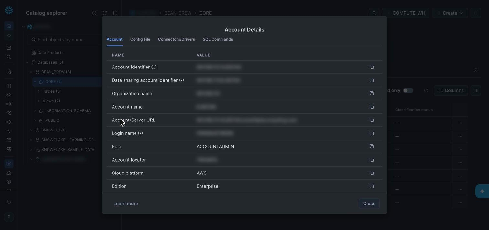

### Run the bootstrap

Run the bootstrap from the repo root. It seeds thousands of rows, applies the policies and creates five key pairs
and service users in one batch:

```bash
venv/bin/python snowflake/bootstrap.py
```

The script asks for your Snowflake password if `SNOWFLAKE_ADMIN_PASSWORD` is blank. If your account requires an
authenticator-app code, run `venv/bin/python snowflake/bootstrap.py --mfa` and enter the code at the hidden prompt.

On a fresh run the script creates:

- The `BB_WH` warehouse and the `BEAN_BREW.CORE` schema, with fictional store data.
- The `RAP_SCOPE` row access policy and the `MASK_SALARY`, `MASK_EMAIL` and `MASK_PHONE` masking policies.
- Five `TYPE=SERVICE` users, each with its own role and RSA key. For example, `BB_BARISTA_SVC` gets role
  `BB_BARISTA` and the public key for `snowflake/keys/barista.p8`.

The private keys stay in the Git-ignored `snowflake/keys/` folder with permissions `0600`. You upload them to
Orchestrate in Step 3. The script refuses to start if any of its named resources already exist.

### Checkpoint

The bootstrap reports five service users. In Snowsight, open **Catalog → Database Explorer** and expand
**BEAN_BREW → CORE**. You see the `STORES`, `INVENTORY` and `EMPLOYEES` tables:

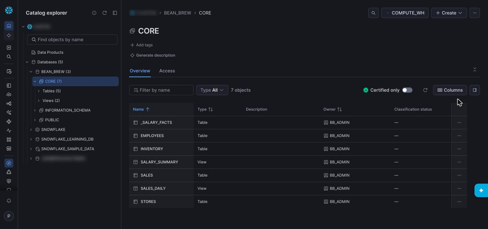

Run these queries in a Snowsight SQL worksheet to check the seed and the policies:

```sql
USE ROLE ACCOUNTADMIN;
USE WAREHOUSE BB_WH;

SELECT COUNT(*) AS STORE_COUNT FROM BEAN_BREW.CORE.STORES;
SELECT ITEM, ON_HAND, REORDER_LEVEL
FROM BEAN_BREW.CORE.INVENTORY
WHERE STORE_ID = 'S01' AND ON_HAND <= REORDER_LEVEL
ORDER BY ON_HAND - REORDER_LEVEL;

SHOW ROW ACCESS POLICIES IN SCHEMA BEAN_BREW.CORE;
SHOW MASKING POLICIES IN SCHEMA BEAN_BREW.CORE;
```

You should see 12 stores and six low-stock items at S01:

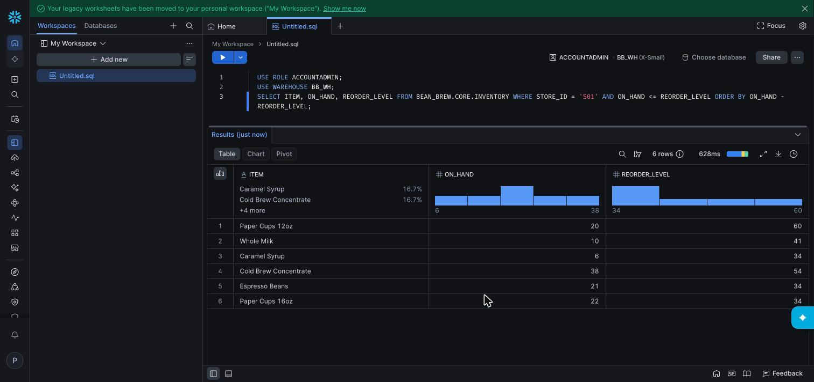

The policy queries list `RAP_SCOPE` and the three masking policies:

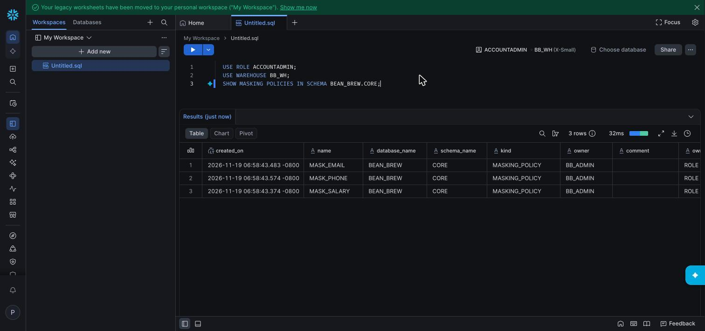

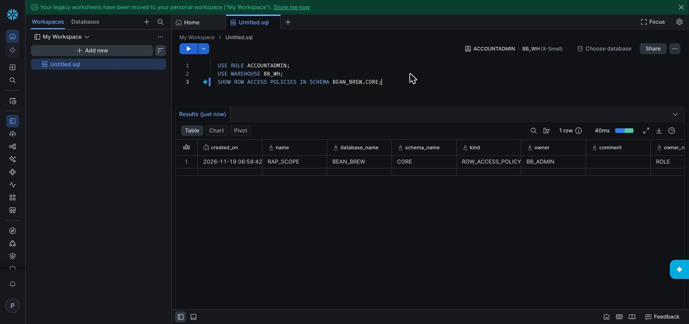

### Verify the role policies

```bash
venv/bin/python tests/test_snowflake_rbac.py
```

The test signs in as each service user. All 16 checks should pass. The two manager update checks write the
existing quantity back to the same rows, so no data changes.

> **Tip:** If setup fails midway, run `SHOW DATABASES LIKE 'BEAN_BREW'`, `SHOW WAREHOUSES LIKE 'BB_WH'`,
> `SHOW ROLES LIKE 'BB_%'` and `SHOW USERS LIKE 'BB_%'` as `ACCOUNTADMIN`. If the checkpoint already passes, carry
> on. Otherwise use a clean lab account, or remove only the objects that run created, then run the bootstrap again.
> Keep the local keys so the script can reuse them.

## Step 3. Create the Snowflake connections in Orchestrate

In this step you give each role its own Orchestrate connection, so each tool call reaches Snowflake as that
role's service user.

### Get the instance URL and API key

1. In watsonx Orchestrate, open the profile menu and select **Settings → API details**.
2. Copy the **Service instance URL** into `WXO_URL` in `.env`. Include the `/instances/…` part.
3. Select **Generate API key** and save the IAM key in `WXO_API_KEY`. You also enter it when the ADK asks you to
   sign in.

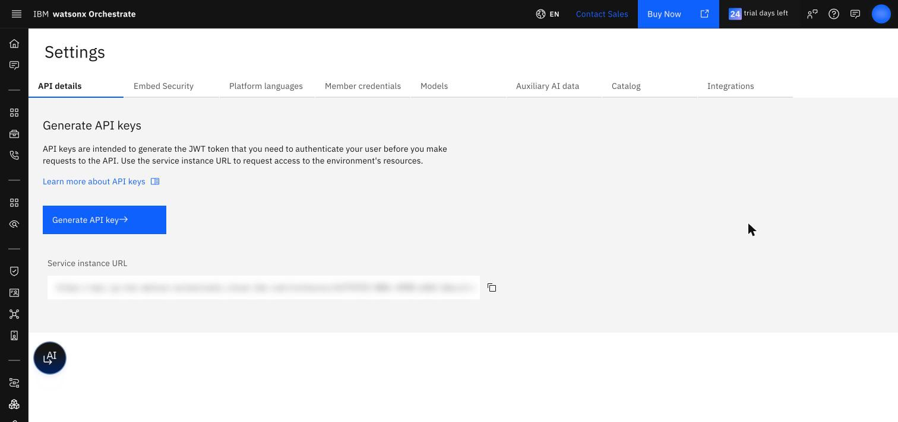

### Add the five connections

| Connection ID | Snowflake user | Key file |
| --- | --- | --- |
| `bb_sf_barista` | `BB_BARISTA_SVC` | `snowflake/keys/barista.p8` |
| `bb_sf_manager` | `BB_MANAGER_SVC` | `snowflake/keys/manager.p8` |
| `bb_sf_regional` | `BB_REGIONAL_SVC` | `snowflake/keys/regional.p8` |
| `bb_sf_finance` | `BB_FINANCE_SVC` | `snowflake/keys/finance.p8` |
| `bb_sf_hr` | `BB_HR_SVC` | `snowflake/keys/hr.p8` |

1. From the main menu, open **Connections** (under **Govern & Operate**) and select the **Custom** filter.
2. Click **Add connection**. Enter the exact **Connection ID** from the table, and use it as the **Display name**
   too.
3. For **Draft**, choose **Key Value Pair** authentication and **Team** credentials. Save, then add these
   credential entries:

   | Key | Value |
   | --- | --- |
   | `account` | The value of `SNOWFLAKE_ACCOUNT`. |
   | `user` | The Snowflake user from the table. |
   | `private_key` | The whole matching `.p8` file, with its line breaks and its PEM header and footer. |

4. Save, then repeat the configuration and credentials for **Live**. Repeat for the other four roles.

The **Custom** list shows all five connections with credentials in both environments:

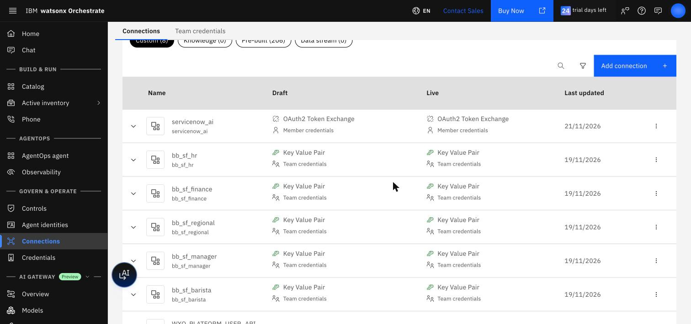

> **Tip:** If your credential editor can't keep the PEM line breaks, skip the manual setup. In Step 4, run
> `bash wxo/scripts/02_connections_tools.sh` instead of the tool import. It reads the account and keys from disk,
> creates the Draft and Live credentials for all five roles and imports the tools.

## Step 4. Import the tools and agents

1. Sign in to the ADK. Enter your IAM key when asked. If `bean-brew-lab` is already registered, run only the
   `activate` command.

   ```bash
   instance_url="$(venv/bin/python -c 'from dotenv import dotenv_values; print(dotenv_values(".env")["WXO_URL"].rstrip("/"))')"
   venv/bin/orchestrate env add --name bean-brew-lab --url "$instance_url" --type ibm_iam
   venv/bin/orchestrate env activate bean-brew-lab
   ```

2. Import the six Python tools and bind them to the five connections:

   ```bash
   venv/bin/orchestrate tools import --kind python --safe \
     --file wxo/tools/bb_tools.py --requirements-file wxo/tools/requirements.txt \
     --app-id bb_sf_barista --app-id bb_sf_manager --app-id bb_sf_regional \
     --app-id bb_sf_finance --app-id bb_sf_hr
   ```

3. Import the two collaborator agents first, so the master can refer to them by name. On a retry, `--safe` asks
   before updating an existing agent.

   ```bash
   venv/bin/orchestrate agents import --safe --file wxo/agents/bb_hr_agent.yaml &&
   venv/bin/orchestrate agents import --safe --file wxo/agents/bb_finance_agent.yaml &&
   venv/bin/orchestrate agents import --safe --file wxo/agents/bb_master_agent.yaml
   ```

**Checkpoint** · Open **Active inventory → Tools** and search for `bb_`. You see the six lab tools:

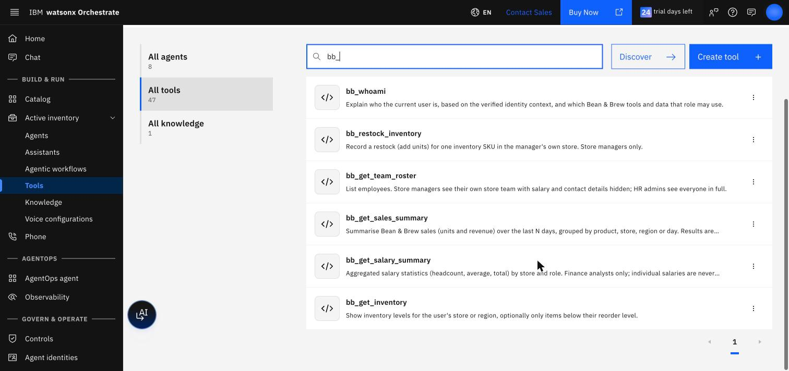

Open **All agents** and search for `Bean`. You see the three lab agents. Select the workspace you imported into if
your tenant has more than one.

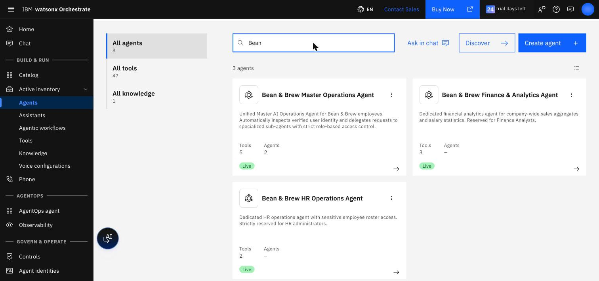

## Step 5. Review the model and deploy the agents

1. Open **Bean & Brew HR Operations Agent** and check the **Model** setting. The YAML selects **Claude Sonnet 4.6
   on Amazon Bedrock** (`bedrock/us.anthropic.claude-sonnet-4-6`). If your tenant marks it unavailable, choose a
   permitted model that supports tool calling, and save. Repeat the check for each agent.

   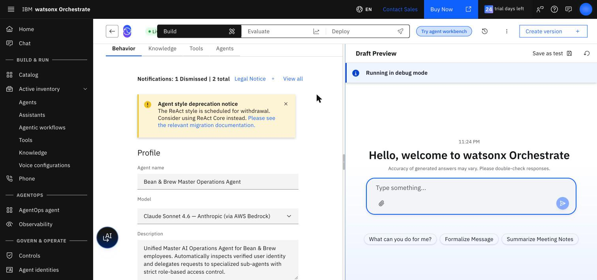

2. Select **Deploy**, review the summary and confirm. If the summary reports missing **Live** credentials, fix the
   connection and try again.
3. Deploy **Bean & Brew Finance & Analytics Agent** next. Then open **Bean & Brew Master Operations Agent**, check
   that both collaborators are listed on its **Agents** tab, and deploy it last.

   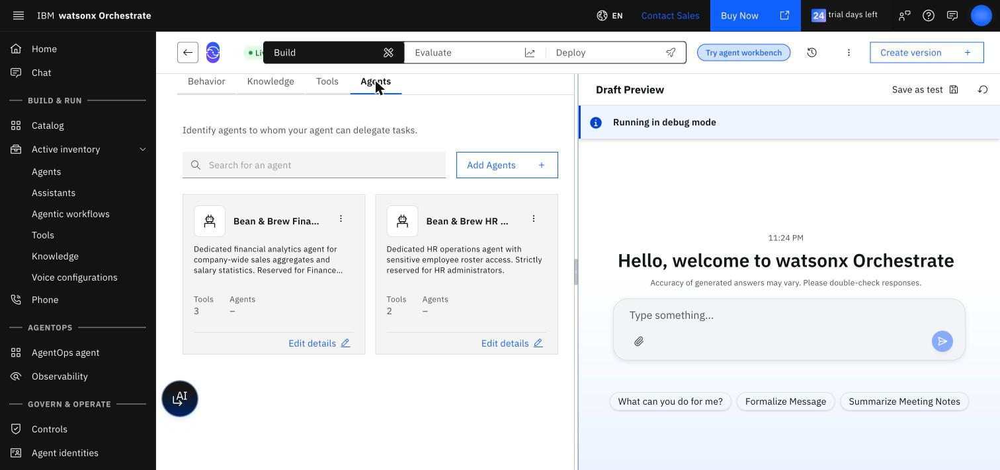

   Each agent shows **Live** on its deployment overview:

   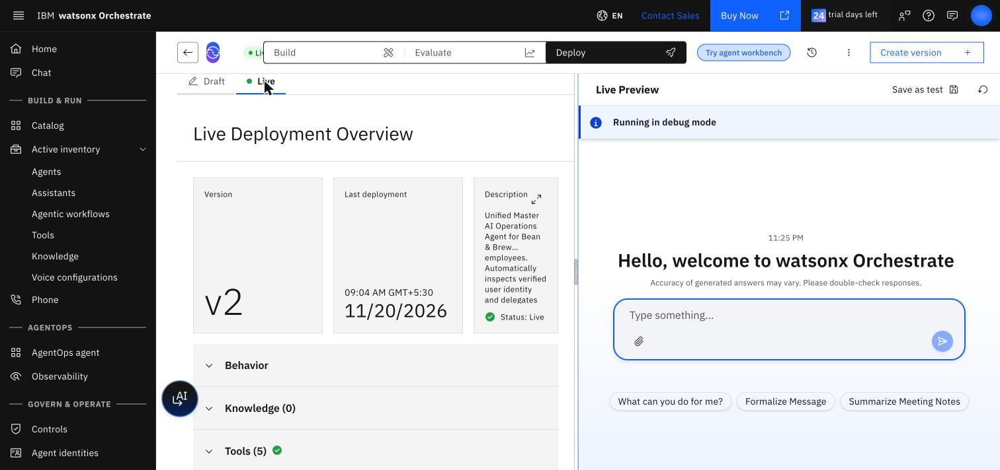

### Copy the master agent ID

1. On the master agent, open **Deploy → Live**, then expand **Channels → Embedded agent**.
2. In the snippet, copy the UUID next to `agentId` inside `chatOptions` into `WXO_MASTER_AGENT_ID` in `.env`. The
   app uses only this value.

   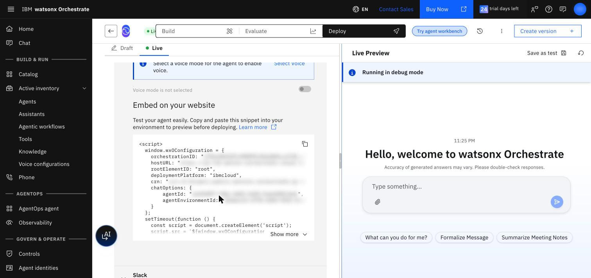

3. If the embed panel isn't available in your tenant, run
   `venv/bin/orchestrate agents list --kind native --verbose` and copy the `id` of the entry whose `name` is
   `bb_master_agent`.

## Step 6. Start Keycloak and the app

You run three local services, each in its own terminal, from the repo root.

1. Generate the demo realm:

   ```bash
   venv/bin/python infra/keycloak/gen_realm.py
   ```

   The generator fills any blank `KEYCLOAK_CLIENT_SECRET`, `DEMO_USER_PASSWORD` and `BFF_JWT_SECRET` in `.env`.
   It writes `infra/keycloak/realm-bean-brew.json` with five users, and enables direct access grants for the
   `bb-web` client so the backend can sign in the demo personas.

2. **Terminal 1 · Keycloak.** Extract the Keycloak 26.8.2 archive. In the extracted folder, create `data/import`
   if it's missing. Copy `infra/keycloak/realm-bean-brew.json` there and rename the copy `bean-brew-realm.json`.
   Then start Keycloak. On Linux, set `JAVA_HOME` to your Java 25 installation instead.

   ```bash
   export KEYCLOAK_DIR="/absolute/path/to/keycloak-26.8.2"
   export JAVA_HOME="$(/usr/libexec/java_home -v 25)"
   "$KEYCLOAK_DIR/bin/kc.sh" start-dev --import-realm \
     --http-host=127.0.0.1 --http-port=8080
   ```

   Keycloak logs `Realm 'bean-brew' imported` on the first start. Open the
   [discovery page](http://127.0.0.1:8080/realms/bean-brew/.well-known/openid-configuration). The JSON shows the
   issuer `http://127.0.0.1:8080/realms/bean-brew`.

3. **Terminal 2 · Backend.**

   ```bash
   venv/bin/uvicorn bff.main:app --host 127.0.0.1 --port 8000
   ```

   Open the [health page](http://127.0.0.1:8000/health). The JSON includes `"status":"ok"`.

4. **Terminal 3 · Front end.**

   ```bash
   npm --prefix frontend run dev -- --host 127.0.0.1 --strictPort
   ```

**Checkpoint** · Open [Bean & Brew](http://127.0.0.1:5173/) and select **Maya Chen**. The header shows `barista`
and `Store S01`. If sign-in fails, the persona picker shows the error.

## Step 7. Test role-based access

In this step you ask the same assistant the same questions as different people, and check that what comes back
is decided by Snowflake, not by the model.

### Exercise 1 · Inventory and a salary request as Maya

1. Select **Maya Chen**. The header shows `barista` and `Store S01`.
2. Click **Check low inventory for my store (S01)**. The first live request takes about 20–30 seconds.
3. Click **Inspect Agent Routing & Tool Audit**. In **Execution Audit**, find `bb_get_inventory` and its response.
   Expand **View Raw Trace JSON** and check that every `store_id` is `S01`. A fresh seed returns six rows;
   `SKU007` (Paper Cups 12oz) has 20 on hand and a reorder level of 60.
4. Ask **Can I see all employee salaries?** Maya is refused: the barista role has no grant on the employee table.

**Record** · How many low-stock rows came back? What role and store does the **Identity & Token** tab show?

### Exercise 2 · The same roster question as Sam and Hana

Click **Switch User**, select **Sam Rivera** and send:

```text
Show the employee roster for Store S01. Include names, roles, and any salary or contact fields I'm allowed to see.
```

Open the audit for `bb_get_team_roster`. In the raw result, the roster lists S01 employees, salary values are
`null`, and contact fields are masked. The agent may leave masked fields out of its prose.

Switch to **Hana Sato** and send the same prompt. Salary and contact fields come back unmasked. Hana's request is
routed to the HR collaborator, which has wider roster access, so the result can include other stores as well.

**Record** · Compare one S01 employee in the two answers. Which fields changed, and which Snowflake policy explains
each change?

### Exercise 3 · Finance aggregates as Felix

Switch to **Felix Weber** and send:

```text
Show salary headcount, average salary, and total payroll by region and role.
```

In the audit, find `bb_get_salary_summary` and identify the three aggregate measures. Finance reads secure
reporting views rather than individual salaries. The Snowflake policy test in Step 2 confirms the grant boundary
directly.

### Optional · Update a preference

As Maya, say **I prefer oat milk**, then **I prefer almond milk now**. Open **Memory** in the inspector: one milk
preference is stored, with the newer value. Switch user and back, then ask **What milk do I prefer?** The app
stores preferences per user in local SQLite.

### Talk track for presenters

- "Maya is signed in as a barista at S01. Her answer comes from the `bb_get_inventory` Snowflake tool."
- "Now Sam and Hana ask for the same roster. Watch which fields change with the signed-in role."
- "The trace ties each answer to a query result, and the Snowflake tests prove the database enforces the policy,
  separately from anything the model says."

### What this shows, and what production needs

Keycloak provides identity claims, the backend passes them to the Orchestrate run, the master agent routes to
tools and collaborators, and each tool reaches Snowflake as a role-specific service user. Snowflake grants, row
access and masking then decide what comes back.

This lab uses a developer-only Keycloak realm with a shared synthetic-user password and direct grants. Role and
scope are inputs in the model-visible tool schema. In production, derive them from trusted runtime identity at
the point of execution, and enforce the scope independently of the model.

## Troubleshooting

| Symptom | What to check |
| --- | --- |
| `No module named 'snowflake'` or `langgraph.checkpoint.sqlite` | Use `venv/bin/python`, and rerun the combined install in Step 1. |
| The ADK reports an expired token | Run `venv/bin/orchestrate env activate bean-brew-lab` and enter your IAM key. |
| The fast setup script reports the wrong environment | Compare the URL you registered with the ADK against `WXO_URL` in `.env`. |
| A tool reports missing credentials | Open the matching connection in **Connections**. Check both Draft and Live, and that the `.p8` file matches the Snowflake user. |
| Import fails because the model is unavailable | Run `venv/bin/orchestrate models list --all --raw`, change `llm` in the three files under `wxo/agents/`, and import again. |
| Agent import says `react_core` is invalid | Check you're on the `bean-and-brew-lab` branch and the YAML uses `style: react`. Import HR and finance before the master. |
| The backend points at the wrong agent | Set `WXO_MASTER_AGENT_ID` to the ID of `bb_master_agent` in the active environment, then restart FastAPI. |
| Keycloak returns an error at sign-in | Check the `bean-brew` discovery page and that `bb-web` allows direct access grants. Match the realm's credentials to `.env`. |
| The chat stays on **Master Agent reasoning & evaluating Zero Trust policies...** | Allow 20–30 seconds for the first lookup. If an error appears, check the FastAPI terminal and the Live deployment's tool connections. |
| The inspector doesn't open on a narrow window | Click **Inspect Agent Routing & Tool Audit** under a completed answer. On narrow screens the inspector opens over the chat. |
| Podman says the machine already exists | You don't need Podman. Use the standalone Java path in Step 6. |
| A local port is already in use | On macOS, run `lsof -nP -iTCP:8080 -iTCP:8000 -iTCP:5173 -sTCP:LISTEN`. Reuse the healthy instance, or stop it with `Ctrl+C` and restart. |

## Clean up

1. Press `Ctrl+C` in the front-end, backend and Keycloak terminals.
2. In Orchestrate, undeploy and remove the master agent first, then the two collaborators. Remove the six `bb_`
   tools, then the five `bb_sf_*` connections. Check that each item belongs to your lab before removing it.
3. In Snowflake, remove the lab objects once the connections are gone: database `BEAN_BREW`, warehouse `BB_WH`,
   roles `BB_ADMIN`, `BB_BARISTA`, `BB_MANAGER`, `BB_REGIONAL`, `BB_FINANCE` and `BB_HR`, and the five
   `BB_*_SVC` users. Keep the private keys only while you still need those users.

---

Original project and licence · [Bean & Brew upstream README](https://github.com/adiDaBEzt/bean-and-brew-wxo/tree/main#readme) (MIT).
