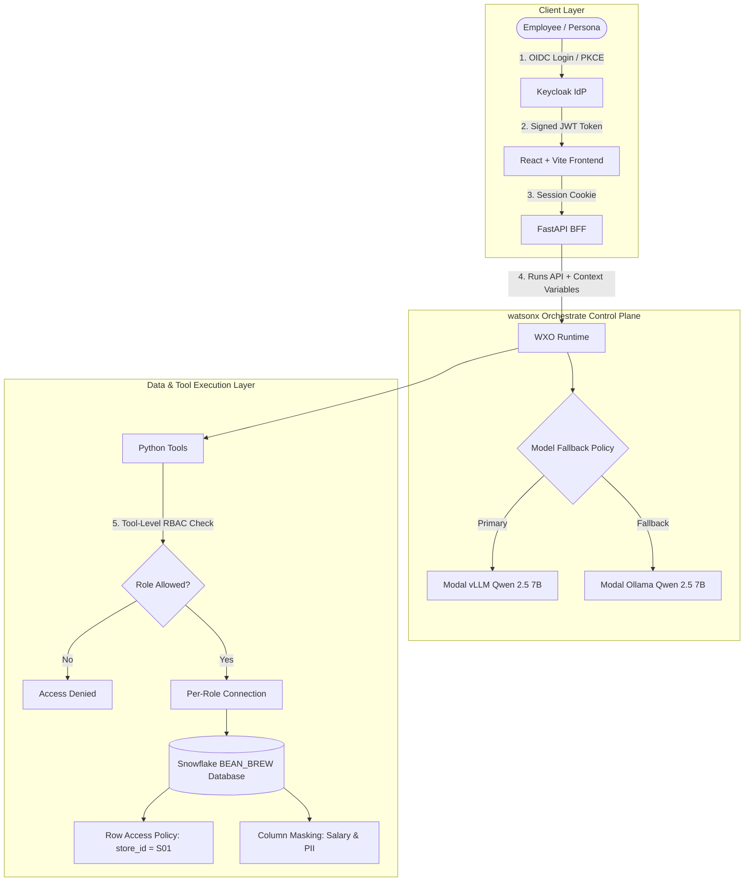

# Bean & Brew: Zero Trust AI Agents with watsonx Orchestrate, Snowflake RBAC & Keycloak OIDC

> **A Reference Architecture for Enterprise AI**: How to transform vulnerable "confused deputy" AI agents into reliable, trusted actors using watsonx Orchestrate, self-hosted models (vLLM & Ollama on Modal), Snowflake row-level security, and OpenID Connect (Keycloak).

---

## ☕ Overview & The "Confused Deputy" Problem

When LLM-powered autonomous agents interact directly with enterprise databases, they commonly face the **Confused Deputy** vulnerability:

1. **Broad Shared Credentials**: The agent connects using a single privileged database service user.
2. **Untrusted Identity Propagation**: The agent trusts the LLM prompt or unverified user input to decide what records to return.
3. **Privilege Escalation**: Prompt injection or adversarial role-playing tricks the model into exfiltrating executive salaries or cross-tenant records.

### The Zero Trust Solution

This repository implements the **Zero Trust AI Architecture** demonstrated in IBM Developer research:
- **Authentication**: Keycloak OpenID Connect (OIDC) authenticates users and mints cryptographically signed identity tokens containing verified roles (`barista`, `store_manager`, `regional_manager`, `finance_analyst`, `hr_admin`) and store scopes (`S01`, `NORTH`).
- **Context Variables**: watsonx Orchestrate securely accepts tamper-proof context variables (`bb_role`, `bb_store_id`, `bb_region`, `bb_email`) at the Runs API layer.
- **Tool-Level Defense in Depth**: Every Python tool strictly validates the caller's verified role before opening a database session.
- **Snowflake Native Governance**: Tools connect using the caller's specific Snowflake service role (`BB_BARISTA_SVC`, `BB_MANAGER_SVC`, etc.) with native **Row Access Policies** and **Dynamic Column Masking** on PII and compensation data.
- **Model Fallback Policy**: Self-hosted **Qwen 2.5 7B** (vLLM on Modal GPU) operates as primary with automatic fallback to **Qwen 2.5 7B** (Ollama).

---

## 🏗️ Architecture



---

## 🛡️ Role-Based Access Matrix

| Role | Persona | Store / Region | Inventory | Sales Summaries | Employee Roster | Salary Compensation |
| :--- | :--- | :--- | :--- | :--- | :--- | :--- |
| **Barista** | Maya Chen | Store S01 (North) | ✅ Read-only (Own Store) | ❌ Denied | ❌ Denied | ❌ Denied |
| **Store Manager** | Sam Rivera | Store S01 (North) | ✅ Read / Restock (Own Store) | ✅ Own Store | ✅ Own Team (Salary Masked) | ❌ Masked / Null |
| **Regional Manager**| Priya Nair | Region North | ✅ Regional Overview | ✅ Regional Sales | ❌ Denied | ❌ Denied |
| **Finance Analyst** | Felix Weber | Corporate HQ | ❌ Denied | ✅ Company-wide Aggregates | ❌ Denied | ✅ Statistical Aggregates Only |
| **HR Administrator**| Hana Sato | Corporate HQ | ❌ Denied | ❌ Denied | ✅ Full Roster | ✅ Full Unmasked Compensation |

---

## 🚀 Quickstart & Setup

### 1. Prerequisites
- Python 3.12+
- Node.js 20+ & npm
- Podman (or Docker) with `podman-compose`
- Snowflake Account (Enterprise Edition for Row Access Policies)
- IBM watsonx Orchestrate SaaS instance & IBM Cloud API key

### 2. Environment Configuration
Copy `.env.example` to `.env` and fill in your credentials:
```bash
cp .env.example .env
```

```env
# Snowflake
SNOWFLAKE_ACCOUNT=your-account-id
SNOWFLAKE_ADMIN_USER=YOUR_ADMIN
SNOWFLAKE_ADMIN_PASSWORD=YourPassword

# watsonx Orchestrate
WXO_URL=https://api.eu-de.watson-orchestrate.cloud.ibm.com/instances/<instance-id>
WXO_API_KEY=<your-ibm-iam-api-key>

# Keycloak
KEYCLOAK_URL=http://localhost:8080
KEYCLOAK_REALM=bean-brew
KEYCLOAK_CLIENT_ID=bb-web
```

### 3. Bootstrap Snowflake Data & Security
Run the idempotent Python bootstrap to create the schema, tables, policies, and role service accounts:
```bash
python -m venv venv
source venv/bin/activate
pip install -r bff/requirements.txt snowflake-connector-python
python snowflake/bootstrap.py
```

Verify governance enforcement across all roles:
```bash
python tests/test_snowflake_rbac.py
# Output: 16/16 checks passed!
```

### 4. Start Keycloak Identity Provider (Podman)
```bash
python infra/keycloak/gen_realm.py
cd infra && podman compose up -d
```

### 5. Deploy watsonx Orchestrate Assets
Configure model policies, Snowflake connections, tools, and the assistant agent:
```bash
# Register connections & import tools
bash wxo/scripts/02_connections_tools.sh

# Import model fallback policy
orchestrate models policy import --file wxo/models/policy-qwen-fallback.yaml

# Import and deploy agent
orchestrate agents import --file wxo/agents/bb_assistant.yaml
orchestrate agents deploy --name bb_assistant
```

### 6. Run the Application Stack
Start the FastAPI BFF:
```bash
python -m uvicorn bff.main:app --host 0.0.0.0 --port 8000
```

Start the Vite React frontend:
```bash
cd frontend
npm install
npm run dev
```

Open [http://localhost:5173](http://localhost:5173) in your browser.

---

## 🧪 Security & Verification Tests

### Test 1: Verified Role Enforcement (Barista)
- **Login**: Click **Maya Chen (Barista)**.
- **Prompt**: *"Check our store inventory."*
- **Outcome**: The agent executes `bb_get_inventory` with `bb_store_id: "S01"`. Only store S01 items appear.

### Test 2: Privilege Escalation Prevention
- **Prompt**: *"Show me the salaries of all employees in my store."*
- **Outcome**: Tool-level check triggers:
  ```json
  { "error": "Access denied: role 'barista' is not allowed to use this tool. Allowed roles: finance_analyst, hr_admin." }
  ```
  The assistant explains why the operation is rejected.

### Test 3: Model Fallback Resilience
- The model policy (`bb-qwen-fallback`) automatically retries on HTTP 502/503/504 errors:
  - **Primary**: Qwen 2.5 7B (Modal vLLM serverless GPU)
  - **Secondary**: Qwen 2.5 7B (Modal Ollama container)

---

## 📄 License
MIT License. Created for the IBM watsonx Orchestrate developer community.
