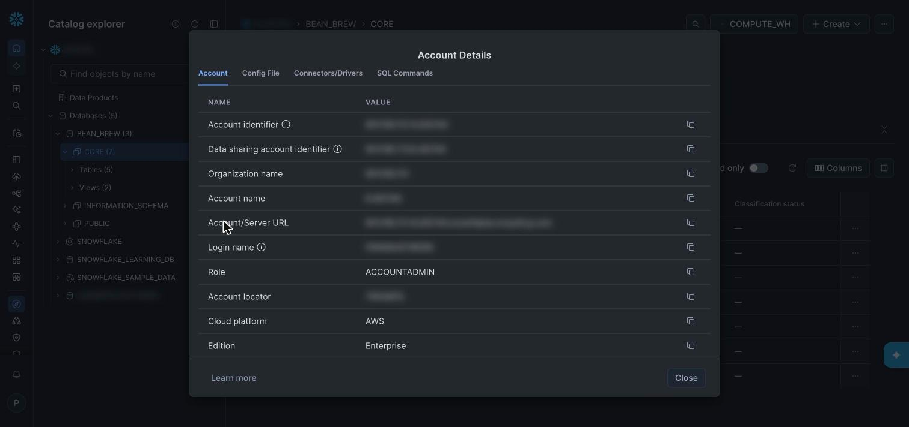
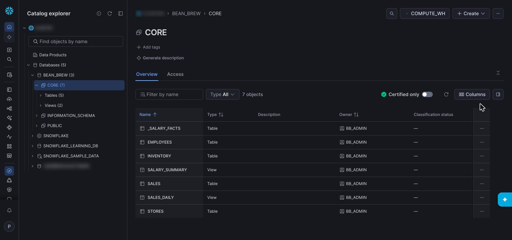
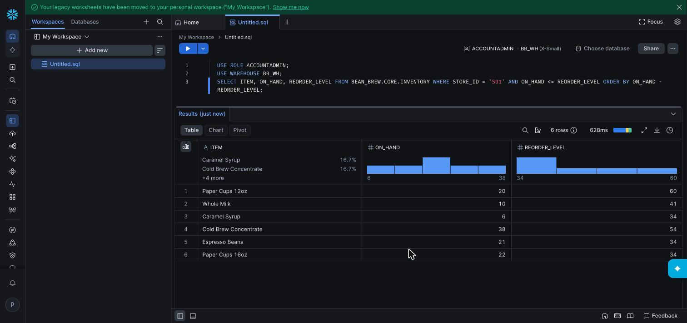
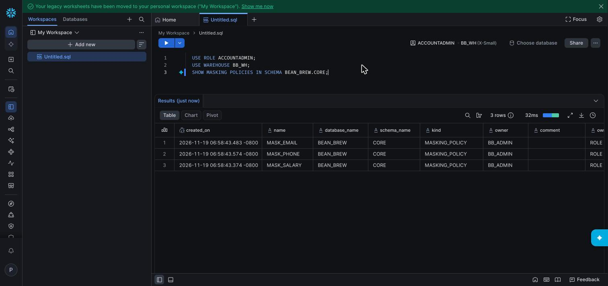
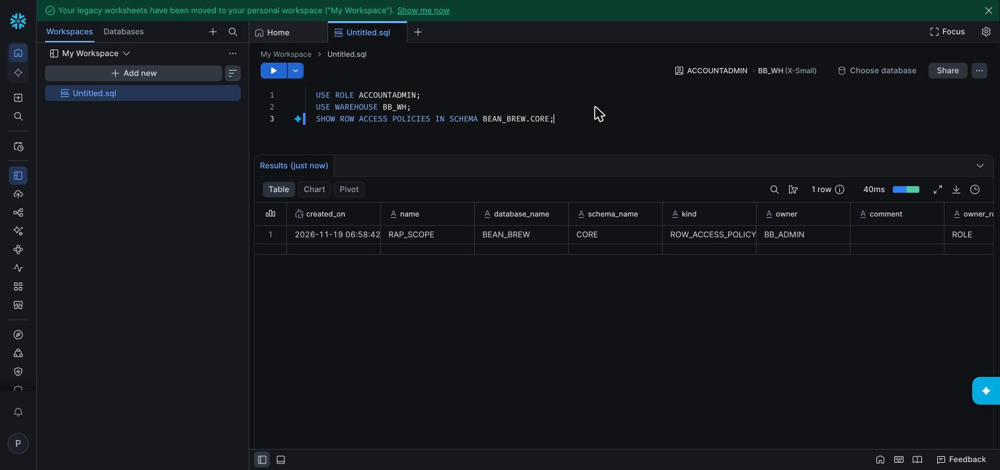

# 1. Provision Snowflake and seed the lab

Create a dedicated Snowflake **Enterprise Edition** trial or use an isolated, approved Enterprise-or-higher lab account. The exercise creates a warehouse, database, roles, and service users with fixed names. Enterprise Edition supports the row access and masking policies used in this lab. [Snowflake trials](https://docs.snowflake.com/en/user-guide/admin-trial-account) · [Row access policies](https://docs.snowflake.com/en/user-guide/security-row-intro) · [Dynamic Data Masking](https://docs.snowflake.com/en/user-guide/security-column-ddm-intro)

## Find your account identifier

1. Sign in to Snowsight with your lab administrator account. Open the account selector and choose **View account details**.
2. Copy the client account identifier in `organization-account` form into `SNOWFLAKE_ACCOUNT` in `.env`. Put your Snowflake username in `SNOWFLAKE_ADMIN_USER`. The username must be able to use `ACCOUNTADMIN`. [Where to find your account identifier](https://docs.snowflake.com/en/user-guide/admin-account-identifier)
3. In Snowsight, open the role selector and confirm you can select **ACCOUNTADMIN** before continuing. If you aren’t sure of the username, run `SELECT CURRENT_USER();` in a Snowsight SQL worksheet.



## Run the bootstrap

Run the bootstrap from the repo root. It seeds thousands of rows, applies the policies, and creates all five keys and users in one batch. The only prompts are for Snowflake sign-in.

```bash
venv/bin/python snowflake/bootstrap.py
```

The script prompts for your Snowflake password if `SNOWFLAKE_ADMIN_PASSWORD` is blank. If your account requires a code from an authenticator app for connector sign-in, run `venv/bin/python snowflake/bootstrap.py --mfa` and enter the current code at the hidden prompt. Follow your account's authentication policy. [Snowflake Python connector MFA](https://docs.snowflake.com/en/developer-guide/python-connector/python-connector-connect#using-multi-factor-authentication-mfa)

The script refuses to start when one of its named lab resources already exists. On a fresh run it creates the `BB_WH` warehouse and `BEAN_BREW.CORE` schema, seeds fictional store data, applies governance policies, and creates five `TYPE=SERVICE` users with dedicated RSA keys. For example, `BB_BARISTA_SVC` receives role `BB_BARISTA` and the public key corresponding to `snowflake/keys/barista.p8`.

Keep the five private keys under the Git-ignored `snowflake/keys/` directory. The bootstrap creates each private key with file permissions `0600`. The next module uploads the private key for each role to its matching Orchestrate connection. [Snowflake key-pair authentication](https://docs.snowflake.com/en/user-guide/key-pair-auth)

## Checkpoint

The bootstrap should report five service users. In Snowsight, open **Catalog → Database Explorer**, find **BEAN_BREW → CORE**, and look for **STORES**, **INVENTORY**, and **EMPLOYEES**. For the exact seed counts and policy names, paste the following into a Snowsight SQL worksheet and run it there:



```sql
USE ROLE ACCOUNTADMIN;
USE WAREHOUSE BB_WH;

SELECT COUNT(*) AS STORE_COUNT FROM BEAN_BREW.CORE.STORES;
SELECT ITEM, ON_HAND, REORDER_LEVEL
FROM BEAN_BREW.CORE.INVENTORY
WHERE STORE_ID = 'S01' AND ON_HAND <= REORDER_LEVEL
ORDER BY ON_HAND - REORDER_LEVEL;

SHOW ROW ACCESS POLICIES IN SCHEMA BEAN_BREW.CORE;
SHOW MASKING POLICIES IN SCHEMA BEAN_BREW.CORE;
```

The sample includes 12 stores and six low-stock items at S01. Look for `RAP_SCOPE`, `MASK_SALARY`, `MASK_EMAIL`, and `MASK_PHONE`. These administrator queries confirm the seed and policies are present. The later exercises check access as the actual demo roles.







## Recover an interrupted setup

Snowflake DDL can leave objects behind if setup fails midway. Read the first error and inspect the lab resources with these commands while using `ACCOUNTADMIN`:

```sql
SHOW DATABASES LIKE 'BEAN_BREW';
SHOW WAREHOUSES LIKE 'BB_WH';
SHOW ROLES LIKE 'BB_%';
SHOW USERS LIKE 'BB_%';
```

If the checkpoint already passes, continue with the existing resources and the original keys. If the run was partial, use a clean lab account or remove only the objects you confirmed were created by that run in your disposable lab account. The lab uses database `BEAN_BREW`, warehouse `BB_WH`, roles `BB_ADMIN`, `BB_BARISTA`, `BB_MANAGER`, `BB_REGIONAL`, `BB_FINANCE`, and `BB_HR`, plus the five corresponding service users. Re-run bootstrap after cleanup. Retain the local role keys so the script can reuse them.

## Verify the role policies

```bash
venv/bin/python tests/test_snowflake_rbac.py
```

The test signs in as each service user. Expect all 16 checks to pass. The two manager update checks assign the existing quantity back to the same rows to verify update scope.

## Clean up a dedicated lab account

After you remove the corresponding Orchestrate connections, remove the lab objects you created in Snowflake when you no longer need them. Use the inventory of database, warehouse, roles, and users above to identify the exact objects in Snowsight. Preserve the private keys only while you still need access to the corresponding service users.

**Next** · [02 · Deploy in watsonx Orchestrate](02-orchestrate.md)
